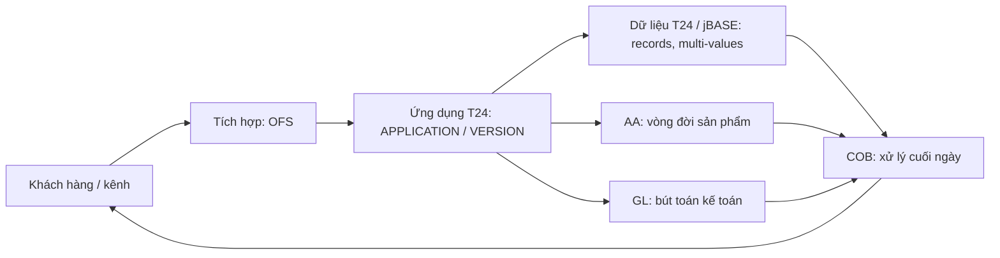

# T24 Core Banking

![[assets/T24-core-banking-overview.png]]

> Trung tâm học tập T24/Temenos Transact. Bắt đầu từ nghiệp vụ ngân hàng, sau đó lần theo dữ liệu và xử lý trong runtime, cuối cùng thực hành tích hợp và vận hành.

## Lối vào

- [[01 - Ghi chú tài liệu đọc trước]] — tổng hợp 5 tài liệu đã đọc; ZIP là bản đóng gói lặp lại một số tài liệu.
- [[02 - Roadmap học T24]] — lộ trình theo chặng, bài tập và tiêu chí hoàn thành.

## Bản đồ khái niệm nhanh

Sơ đồ chỉ là mô hình học tập khái quát; cấu hình và thành phần thực tế phụ thuộc phiên bản, module được cấp phép và triển khai tại ngân hàng.

## Nguyên tắc khi học

- Nối mỗi khái niệm kỹ thuật với sự kiện nghiệp vụ: khách hàng, tài khoản, giao dịch, bút toán, phê duyệt và chốt ngày.
- Bắt đầu từ môi trường/lab được cấp quyền; không chạy lệnh ghi, compile hoặc COB trên môi trường dùng chung khi chưa rõ phạm vi.
- Tài liệu *Right Ho, T24* (2015) và *Common Variables* (2014) hữu ích để hiểu khái niệm nhưng có thể khác release hiện hành. Xác minh cú pháp, API và convention với tài liệu đúng phiên bản của môi trường.
