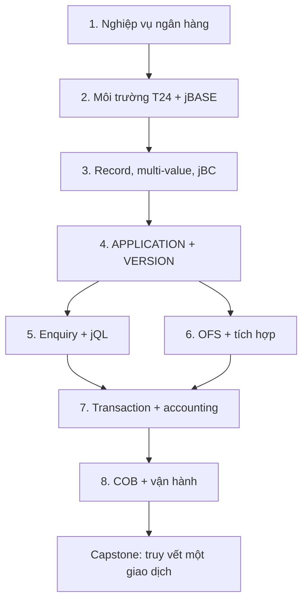

# Roadmap học T24 / Temenos Transact

Mục tiêu cuối: có thể giải thích một luồng nghiệp vụ đầu-cuối, đọc một xử lý jBC/T24 nhỏ trong lab, truy vấn/kiểm tra dữ liệu có kiểm soát, và lần theo OFS/log/kế toán/COB khi có lỗi.

## Bản đồ chặng

## Chặng và tiêu chí hoàn thành

| # | Chặng | Học và thực hành | Tiêu chí qua chặng |
|---:|---|---|---|
| 1 | **Nền tảng nghiệp vụ** | Core banking, khách hàng/tài khoản, sản phẩm, GL, AA, giao dịch, ngày nghiệp vụ và COB. Dùng slide khóa học; vẽ một khoản tiền đi từ kênh vào tài khoản tới bút toán. | Giải thích được vì sao dữ liệu tài khoản, cấu hình sản phẩm và GL liên kết nhưng không đồng nhất. |
| 2 | **Môi trường và kiến trúc** | Phân biệt T24/Transact, jBASE, TAFC, TAFJ, jsh, T24 Classic/Browser, môi trường DEV/UAT. Đọc `jdiag`/cấu hình chỉ trong lab. | Vẽ được nơi chạy source, runtime, data và client; nhận biết hệ thống đang dùng TAFC hay TAFJ theo bằng chứng. |
| 3 | **Record và jBC căn bản** | Đọc @ID/record, file, hashed/UD, field/value/sub-value, `R.NEW`/`R.OLD`; thực hành đọc/ghi trong sandbox; học biến, array động, `IF`, `CASE`, loop, `CALL`, `EQUATE`. Tra *Right Ho* tr. 49–69 và *Common Variables*. | Đọc được một đoạn jBC ngắn, xác định input/output và cấu trúc multi-value; không nhầm index hiển thị với số field vật lý. |
| 4 | **Application, VERSION, validation** | Function và vòng đời input–validation–override–authorization; field mapping, default, cross-validation, no-input field, history. Tra *Right Ho* tr. 69–100, 126–144; Subroutine Guide nhóm validation/override. | Mô tả được một record đi qua validate/authorize và chỉ ra nơi lưu lỗi/override trong ví dụ lab. |
| 5 | **Truy vấn, enquiry, dữ liệu** | jQL, SELECT/list, ENQUIRY, multi-value retrieval, I/J-descriptor, local field. Tra *Right Ho* tr. 144–213 và 283–289. | Tạo được truy vấn chỉ đọc trong dữ liệu lab; giải thích điều kiện, kết quả và giới hạn truy vấn. |
| 6 | **Subroutine và giao dịch tích hợp** | Routine chuẩn: đọc/ghi, ngày/tiền tệ, message/error, rate, file/lock; OFS message, protocol/log. Tra Subroutine Guide và *Right Ho* tr. 100–129, 158–177, 189–213. | Phác họa request → T24 application → response; dùng routine chuẩn đúng chữ ký thay vì tự viết lại tiện ích nếu được hỗ trợ. |
| 7 | **Giao dịch và kế toán** | Theo một giao dịch tài chính từ input tới record/protocol và accounting entries/GL. Tra *Right Ho* tr. 213–239. | Nối được dữ liệu giao dịch với bút toán dự kiến; biết chỗ cần kiểm tra nếu lệch. |
| 8 | **COB và vận hành** | Thứ tự job, agent tSM/tSA theo tài liệu, lock, trạng thái ngày, thời lượng và log; tra *Right Ho* tr. 234–251, 348–351. Chỉ thao tác trên môi trường được cho phép. | Giải thích được COB làm gì, đọc được tình trạng/điểm lỗi từ log lab, phân biệt chạy lại an toàn với thao tác cần phê duyệt. |
| 9 | **Tooling và delivery** | Đọc hướng dẫn VS Code; cấu hình extension/Run on Save trong lab. Compile/catalog, test, versioning và delivery; tra *Right Ho* tr. 255–289, 343–344. | Compile được một thay đổi không gây tác dụng phụ trong lab và ghi rõ phiên bản/config dùng. |
| 10 | **Capstone: truy vết giao dịch** | Dùng dữ liệu giả/lab: mô tả nghiệp vụ → tìm application/version → lần theo OFS hoặc input → kiểm tra record và validation → đối chiếu bút toán/GL → xác định ảnh hưởng COB → viết checklist troubleshooting. | Một sơ đồ luồng, truy vấn read-only, dấu vết log/bút toán và ghi chú nguyên nhân/giới hạn có thể được người khác review. |

## Nhịp gợi ý

- **Tuần 1:** chặng 1–2; làm glossary và sơ đồ kiến trúc theo đúng lab.
- **Tuần 2:** chặng 3–4; đọc và giải thích ví dụ record/jBC, chưa sửa môi trường dùng chung.
- **Tuần 3:** chặng 5–6; thực hành enquiry chỉ đọc và phân tích một OFS sample.
- **Tuần 4:** chặng 7–9; theo dấu một giao dịch, học COB và compile trong lab.
- **Tuần 5:** chặng 10; hoàn thành capstone và review với người hướng dẫn.

Nhịp này là đề xuất tự học, không phải lịch chính thức của khóa học. Nếu đã biết jBC hoặc ngân hàng, có thể gộp chặng nhưng vẫn giữ capstone.

## Checklist khởi động

- [ ] Xác nhận release/build, runtime (TAFC hay TAFJ), cấu trúc DEV/UAT và quyền truy cập lab.
- [ ] Xin bộ tài liệu chính thức đúng release và convention nội bộ.
- [ ] Cài/configure VS Code chỉ theo đường dẫn JDK/TAFJ mà lab cấp.
- [ ] Chọn một luồng nghiệp vụ nhỏ, có dữ liệu giả và không ghi lên môi trường dùng chung.
- [ ] Ghi lại thuật ngữ chưa rõ vào [[01 - Ghi chú tài liệu đọc trước]].

## Ghi chú về độ tin cậy

Roadmap tổng hợp từ 5 tài liệu trong thư mục đọc trước. *Right Ho, T24* (2015) và *Common Variables* (2014) là nguồn cũ; một số ví dụ thiên về TAFC/jBASE. Xác nhận lệnh, include, field, routine và luồng COB theo release thực tế trước khi áp dụng.
